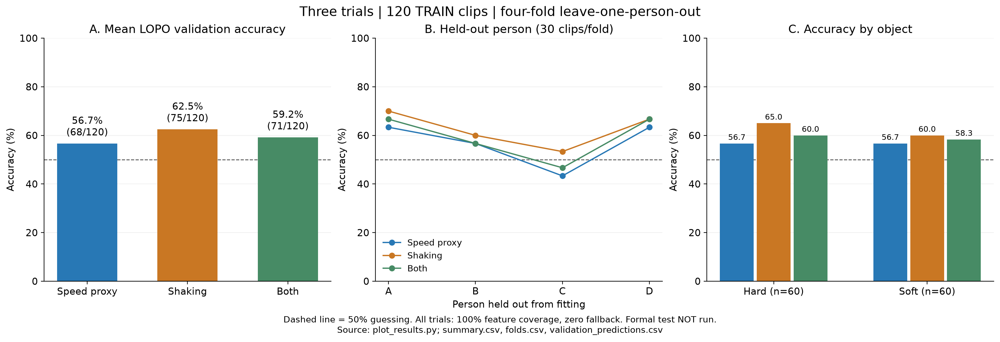
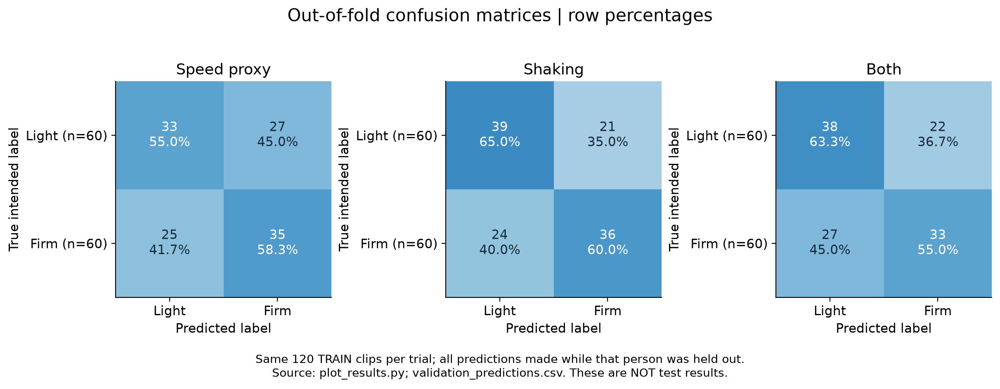
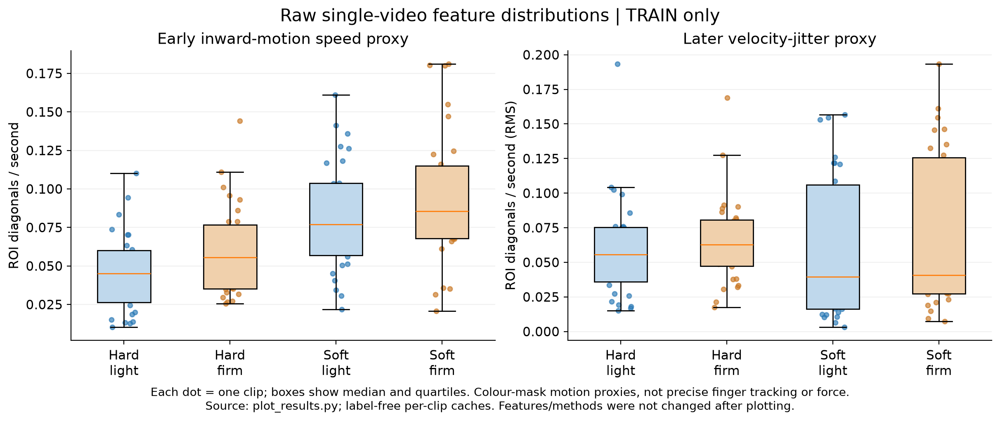

# Qian L — Section C: speed, shaking and both

Three landmark-free trials for classifying a whole grip video as **light** or **firm**, using the group's fixed Part 3 protocol. These labels describe the participant's intention, not measured force.

**Status: training validation completed; final method proposed, not frozen; the formal 40-clip test has NOT been run.** This folder does not change the shared split or other members' code.

## Results: train-only leave-one-person-out validation

Each fold fits on 90 train clips from three people and predicts all 30 train clips of the held-out person. All trials have 120/120 usable features and zero fallback predictions in this run.

| Trial | Features | Selected C | Leave A out | Leave B out | Leave C out | Leave D out | Mean / total | Hard | Soft |
|---|---:|---:|---:|---:|---:|---:|---:|---:|---:|
| Speed proxy | 4 | 1.0 | 19/30 | 17/30 | 13/30 | 19/30 | 68/120 = 56.7% | 34/60 = 56.7% | 34/60 = 56.7% |
| Shaking proxy | 4 | 0.1 | 21/30 | 18/30 | 16/30 | 20/30 | **75/120 = 62.5%** | 39/60 = 65.0% | 36/60 = 60.0% |
| Both | 8 | 0.1 | 20/30 | 17/30 | 14/30 | 20/30 | 71/120 = 59.2% | 36/60 = 60.0% | 35/60 = 58.3% |

Guessing baseline: **50%**. Mean validation accuracy selects **shaking + logistic regression (C=0.1)**. Adding speed did not improve this validation result. These are method-selection scores, not nested-CV unbiased estimates or final test scores. They do not establish reliable grip-force measurement or that firm grips always shake more.



*Generated by `plot_results.py` from `summary.csv`, `folds.csv` and out-of-fold predictions. All 120 train clips are included; the dashed line is 50%.*



*Generated by `plot_results.py`. Rows are true intended labels; columns are predictions; percentages are within each row. These are validation, not test, predictions.*



*Generated by `plot_results.py`. Each dot is one train clip; boxes show medians and quartiles. These image-motion proxies are not precise finger tracking or force measurements.*

## Shared data and fixed split

The only data source is the repository's existing shared directory:

```text
Part3/data/labels.csv
Part3/data/split.csv
Part3/data/videos/          # original MOV files, if supplied locally
Part3/data/videos_480p/     # corresponding mp4 files used by this method
Qian L/                    # this implementation
```

There are 160 clips: 4 people × 2 objects × 2 labels × 10 clips. `split.csv` defines 120 train / 40 test. The test has 10 clips per person (5 light, 5 firm), 20 per object and 20 per label. `labels.csv` may also contain an `original` filename column.

Every runnable Python file prints and checks the MD5 fingerprint of the sorted **original test `file` values**: **3696c80d**. It stops on mismatch. The split is never redrawn, re-seeded or edited; `make_split.py` is never run. Frames stay together within their clip, and duplicate original source identities are checked. The protocol helpers also run this check when executed directly.

No videos, shared CSV copies, virtual environment, extraction caches, old models or raw video-frame previews are added by this folder. Raw videos must be available locally for re-extraction; saved validation CSVs can be inspected immediately.

## What the three trials calculate

Every decoded frame of the 30 fps mp4 copy is processed. Resize with aspect ratio preserved to long edge 320. The mixed hand/object ROI is x=0.20–0.80, y=0.30–0.78; the background ROI is x=0.05–0.95, y=0.08–0.23. Fixed YCrCb thresholds select skin-colour-like pixels (Y>35, Cr=133–180, Cb=70–135). This is a coarse heuristic, not a learned or verified hand segmenter. No MediaPipe or hand joints are used.

1. **Speed proxy:** fixed early window, 10%–45% of the clip. Adjacent-frame Farneback flow over selected pixels is centred by their median flow to reduce bulk translation. Four features average per-frame local speed mean/p90 and positive inward speed mean/p90 towards the selected region's centroid. Units: ROI diagonals/second. This may reflect visible finger curling but also palm rotation, lifting and mask errors; it is not fingertip-position or exact finger-speed measurement.
2. **Shaking proxy:** fixed later window, 45%–85%. Selected-region median flow minus background median flow forms a signed velocity sequence. Features: linearly detrended integrated-position RMS, velocity RMS after subtracting a 0.33 s moving average, acceleration RMS, and direction-reversal rate. Reversals require residual speed >0.002 ROI diagonals/second on both adjacent samples. These are temporal variability measures, not mean speed renamed as shaking. Constant translation and oscillation are distinguished in a synthetic check. They are not established physiological tremor measures.
3. **Both:** concatenate those two four-feature groups, without additional features or a different split.

The two endpoints of each frame pair must lie within the same phase. Windows are approximate recording phases, not detected contact or verified holding intervals. Shaking is not filtered out by selecting only low-motion frames. Normalisation by per-clip size/time and single-video detrending use only that video and do not learn population parameters.

## Validation, selection and failures

`LeaveOneGroupOut(groups=person)` operates only on the 120 train clips. `StandardScaler` and `LogisticRegression` are fitted together in a fresh sklearn Pipeline within each fold. No scaler, imputer, PCA, feature selection, classifier, hyperparameter, threshold or early-stopping choice sees test clips. There is no cross-video fitted preprocessing outside the Pipeline.

Each of the three trials compares C=0.1 and C=1.0. Choose C within a trial, then the final trial, by **mean all-clip validation accuracy**. Ties prefer fewer features, then smaller C, then method name. Logistic regression uses random_state=0 and one seed; no seed averaging. `summary.csv` contains exactly three selected-trial rows; `tuning.csv` retains all six parameter combinations. Six parameter combinations are not presented as six main trials.

A frame pair needs ≥30 selected pixels. A phase needs ≥8 valid pairs and ≥70% valid-pair coverage. For shaking, only internal gaps of at most two consecutive invalid frames are linearly interpolated for uniform temporal sampling; longer gaps fail that trial. Both requires both groups to succeed.

Failure policy is fixed before evaluation: fit the classifier on usable fold-training features; predict unusable validation/test clips using the majority among **all** fold-training/final-training labels, ties light. If usable training features contain fewer than two classes, use the same fallback for all predictions. Keep all 30/120/40 clips in denominators and report model coverage, fallback counts and selective accuracy separately. In this run there are no failed features or fallback predictions. **100% feature coverage does not mean 100% reliable hand tracking.**

## Reproduce locally / in VS Code

From the repository root, using that repository's own environment:

```powershell
.\.venv\Scripts\python.exe -m pip install -r "Qian L/requirements.txt"
.\.venv\Scripts\python.exe "Qian L/run_validation_and_plot.py"
```

Or run each stage:

```powershell
.\.venv\Scripts\python.exe "Qian L/explore.py"
.\.venv\Scripts\python.exe "Qian L/verify.py"
.\.venv\Scripts\python.exe "Qian L/plot_results.py"
```

In VS Code, open the **Qian L** folder, choose **Section C: validate + verify + plots**, and press **Ctrl+F5**. `.vscode/launch.json` selects `../.venv/Scripts/python.exe` and uses the Debug Console. This command validates and plots; it does not freeze the method or run a formal test.

Per-clip caches are label-free and checked against absolute source path, source SHA256, fixed configuration and extraction code. They save atomically after each clip and support resume. No caches are committed; the first run in a new checkout extracts the 120 train clips. The migration preserved the extraction formulas and added a direct-run protocol check. Cache reuse requires matching paths, source content, configuration and actual code hashes; mismatches are regenerated. The final pre-upload verification confirms 120/120 cache hits.

`verify.py` recomputes all 720 out-of-fold predictions across 24 fold fits, checks fold-training scaler means and model serialization, tests fallback and fingerprint rejection, and checks a temporary train-only freeze and repeated-test guard. Its deliberately bad fingerprint exists only in temporary test metadata; the real split is untouched. It refuses development verification after a formal-test marker exists. `explore.py` similarly refuses silent development once the real method is frozen or tested.

## Final test — prepared but NOT executed

After the features, model and hyperparameters have been fully chosen on validation, run:

```powershell
.\.venv\Scripts\python.exe "Qian L/FinalMethod.py" --freeze
.\.venv\Scripts\python.exe "Qian L/FinalMethod.py" --run-test
```

Freeze verifies unchanged code, metadata, training video content and validation predictions, refits the selected Pipeline on all 120 train clips under the fixed failure policy, saves/reloads it and records hashes. It does not extract test features. The final script checks the freeze and creates an exclusive marker before any test extraction. Repeated tests and freeze overwrites are refused; interrupted tests keep their marker and must be disclosed, not silently retried.

The single headline test will report correct/40 and accuracy, 95% two-sided **Clopper–Pearson exact binomial CI**, one-sided binomial p-value versus 50%, per-person and per-object accuracy/coverage, confusion matrix and fingerprint. Binomial statistics assume independent clips and do not correct dependence between clips from the same person. Do not select among the three trials after seeing test results. Any post-test method change must be disclosed. No extension/ablation test is claimed complete.

## Limitations and historical exposure

Training diagnostics show that the colour mask also selects parts of pale walls/tables, hand/object parts sometimes leave the ROI, and fixed windows can include approach/lift/release. Lighting, background, skin colour, rotation, recording habits and imperfect background flow can confound the features. Slow movement may be attenuated by detrending; high-frequency motion is limited by the 30 fps input. No thresholds or methods were changed in response to the latest plots.

The fixed test is **not historically pristine**: original-name/person/object/label matching found 27 current test clips in the old train set, 3 in old validation, and 10 in the old D test. The first 30 have historical artifacts. Artifact presence does not prove who viewed them; the complete human-viewing list is unknown. `historical_exposure.csv/json` records metadata identity matching, not binary-content equivalence. Old ROI/preprocessing development used A–C, so correct current fold-local fitting does not undo historical preprocessing exposure. Keep this limitation in any report and do not replace the group's fixed split.

This folder contains the requested three current trials. The coursework exploration tree still needs real historical attempts and actual member contributions; no extra trials, discussions, predictions or contributions are invented. Previous-protocol scores are not mixed into the current comparison. A whole-person hold-out may be an extra experiment, but it cannot replace the fixed headline test. The final report must retain the required six headings and page limit, and figure captions must name their generating code.

## Evidence

- `results/summary.csv`, `tuning.csv`, `folds.csv`: selected trials, parameter comparisons, per-fold/object counts and coverage.
- `results/validation_predictions.csv`, `extraction_status.csv`: every validation prediction and feature status.
- `results/proposed_method.json`, `verification.json`, `publication_review.json`: method choice, checks, data/code hashes and pre-upload audit.
- `results/figures/`: PNG/SVG figures, plotted validation predictions, raw train features and a figure manifest.
- `PROTOCOL.md`: the shared rules in one place.

AI provenance is stated in each script's CODE MAP. No exact model settings or human contributions are invented.
